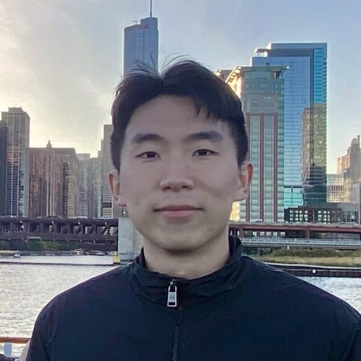

<header>
  

    <h1>Sunwoo Kim</h1>
    
<a href="https://www.csl.cornell.edu/">Computer Systems Laboratory</a>, Cornell University

    

      <a href="https://scholar.google.com/citations?user=yGwOFuQAAAAJ"><i class="fas fa-graduation-cap"></i>Google Scholar</a>
      <a href="https://github.com/sunwookim028"><i class="fab fa-github"></i>GitHub</a>
      <a href="https://www.linkedin.com/in/sunwookim028"><i class="fab fa-linkedin"></i>LinkedIn</a>
      <a href="https://drive.google.com/file/d/1l6vA1RxwvN9bP9m_ffADU_GnCCTAF7my/view?usp=sharing"><i class="fas fa-file-lines"></i>CV</a>
      <a href="mailto:sk3463@cornell.edu"><i class="fas fa-envelope"></i>Email</a>
    

  

  

    
  

</header>

<section id="about" markdown="1">
I am a second-year Ph.D. student in Electrical and Computer Engineering at Cornell, advised by [Prof. Zhiru Zhang](https://www.csl.cornell.edu/~zhiruz/). I received my B.S. from Seoul National University.
</section>

<section markdown="1">
## Research

I research **AI systems co-design** and the **design automation** that supports it.

- **AI systems**: modeling tiered memory architecture for LLM training and serving; designing and scheduling asynchronous execution in accelerators; augmenting and specializing small language models.
- **Design automation**: building and evaluating agentic workflows for co-design; designing formal languages that complement LLMs.

I also build and maintain research **infrastructure**.

- **MiniTPU**: a full-stack tensor accelerator, spanning a VLIW architecture, a 45nm physical design, FPGA prototypes, firmware and runtime, a Triton compiler backend, and a serving engine. Used in several research projects and as the lab platform for Cornell's [AI Hardware course](https://www.csl.cornell.edu/courses/ece4950fa26/).
- **[Allo](https://github.com/cornell-zhang/allo)**: our group's open-source, MLIR-based high-level synthesis framework; I am a core contributor.
</section>

<section id="publications">
  <h2>Publications</h2>
  
  

    

      
{{ pub.title }}

      
{{ pub.authors }}

      
{{ pub.venue }}

      
<a href="{{ l[1] }}">{{ l[0] }}</a>

    

  

  
</section>

<section markdown="1">
## Service

Artifact Evaluation Committee

ASPLOS’27, MICRO’26, SOSP’26, MLSys’26

</section>
